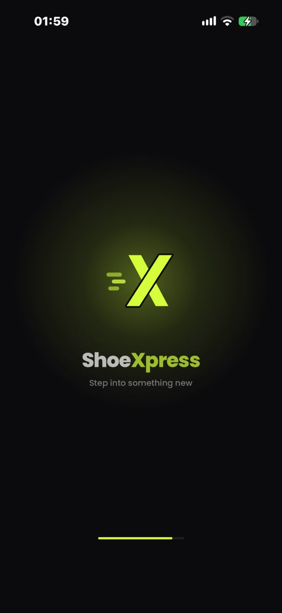
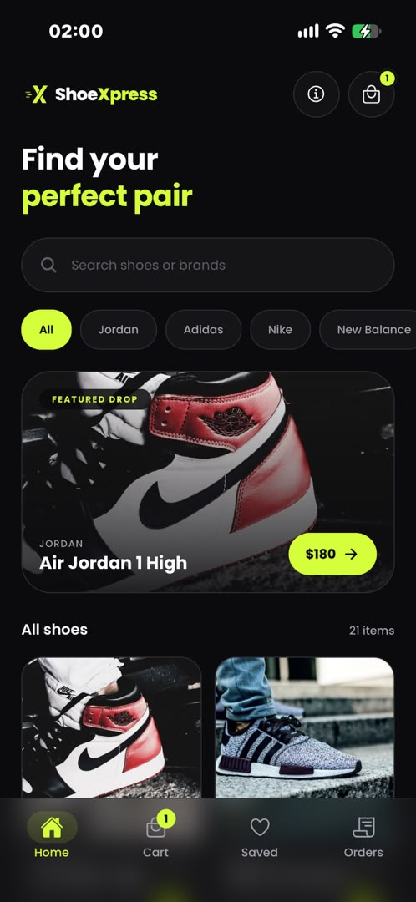
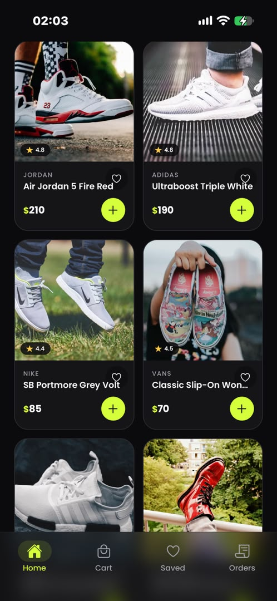
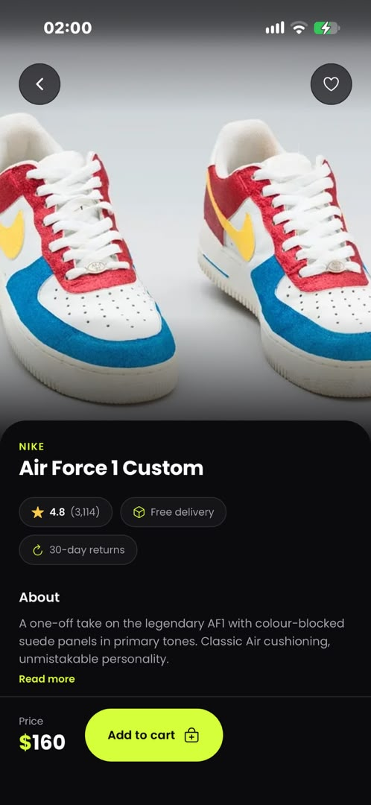
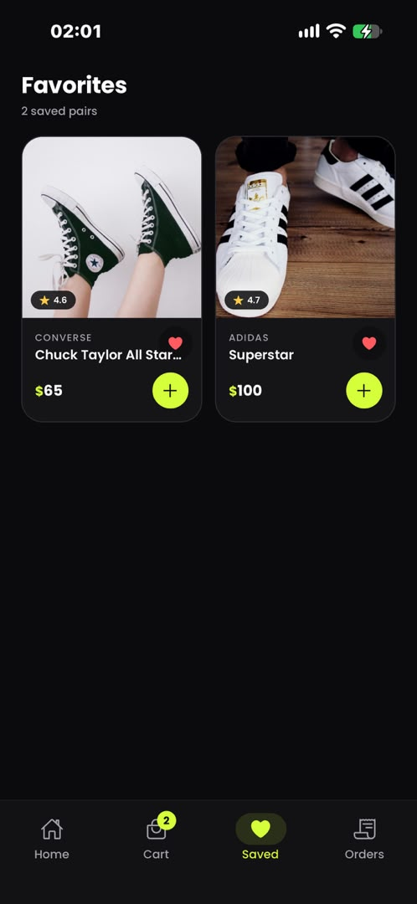
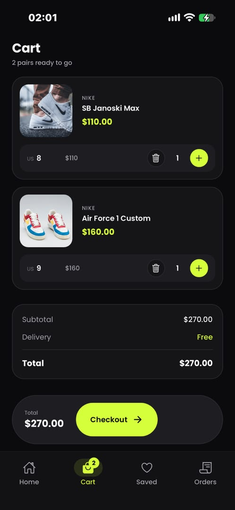
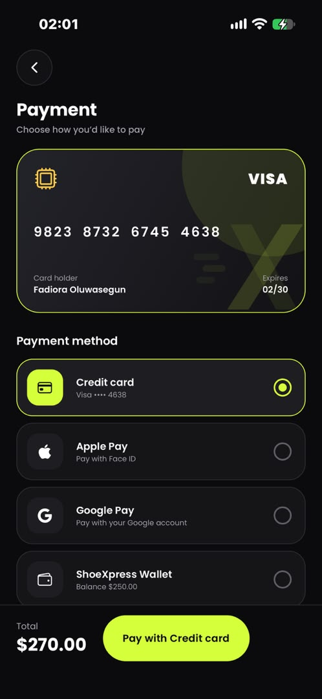
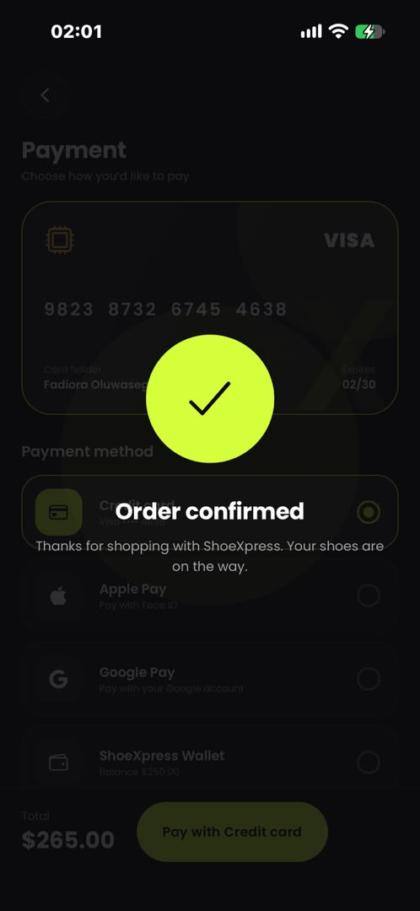

<p align="center">
  
</p>

<h1 align="center">ShoeXpress</h1>

<p align="center">
  A modern sneaker store app built with <a href="https://expo.dev">Expo</a> and React Native.
</p>

<p align="center">
  
  
  
</p>

## Screenshots

<table>
  <tr>
    <td align="center"><br /><sub>Launch</sub></td>
    <td align="center"><br /><sub>Home</sub></td>
    <td align="center"><br /><sub>Catalog</sub></td>
    <td align="center"><br /><sub>Details</sub></td>
  </tr>
  <tr>
    <td align="center"><br /><sub>Favorites</sub></td>
    <td align="center"><br /><sub>Cart</sub></td>
    <td align="center"><br /><sub>Payment</sub></td>
    <td align="center"><br /><sub>Order confirmed</sub></td>
  </tr>
</table>

## Features

- **Animated launch screen** and a **welcome walkthrough** on first launch
- **Browse** 21 sneakers and boots across Nike, Jordan, Adidas, New Balance, Vans, Converse and Dr. Martens
- **Search** by model or brand, filter with brand chips, and a featured drop banner
- **Product details** with a parallax photo, ratings, description and US sizes 7–11
- **Favorites** saved with one tap
- **Cart** with per-size quantities, an order summary and a floating checkout bar
- **Checkout** with card, Apple Pay, Google Pay or wallet, and an animated order confirmation
- **Order history** with order numbers, dates and items
- Sign up, log in and reset password screens with input validation
- Cart, favorites and orders are saved on the device
- Dark theme with a volt accent, haptic feedback, fade-in images and a frosted tab bar

## Tech stack

| | |
|---|---|
| Framework | Expo SDK 58, React Native 0.88, React 19 |
| Navigation | React Navigation 7 (native stack + bottom tabs) |
| State | Zustand 5 + Immer, persisted with AsyncStorage |
| UI | expo-image, expo-linear-gradient, expo-blur, expo-haptics, react-native-svg, @expo/vector-icons |
| Testing | Jest (jest-expo) + React Native Testing Library |

## Getting started

```sh
npm install
npx expo start
```

Scan the QR code with **Expo Go** on your phone, or press `i` for the iOS simulator or `a` for the Android emulator.

> Expo Go shows its own icon and splash screen. To see the ShoeXpress app icon and splash, make a development build with `npx expo run:ios` / `npx expo run:android` or [EAS Build](https://docs.expo.dev/build/introduction/).

| Command | What it does |
|---|---|
| `npm start` | Start the dev server |
| `npm test` | Run the tests |
| `npm run lint` | Lint the project |

## Project structure

```
App.jsx                 Fonts, splash, launch screen, navigation, toasts
src/
  Constants/            Theme (colors, type, spacing), shoe catalog, photo credits
  components/           ShoeCard, CartItem, OrderHistoryCard, SuccessOverlay, ...
  components/ui/        Design-system pieces: Button, TextField, Logo, EmptyState, ...
  navigations/          Stack and tab navigators
  screens/              Launch, Welcome, auth, Home, Details, Cart, Payment, ...
  store/                Zustand store (cart, favorites, orders)
assets/                 App icon, adaptive icon, splash, favicon
docs/screenshots/       README screenshots
```

## Notes

- Sign up and login are front-end only for now: they validate input but don't connect to a backend.
- Product photos are CC0 (public domain) from StockSnap and rawpixel. Photographers are credited in the app under **About**.
